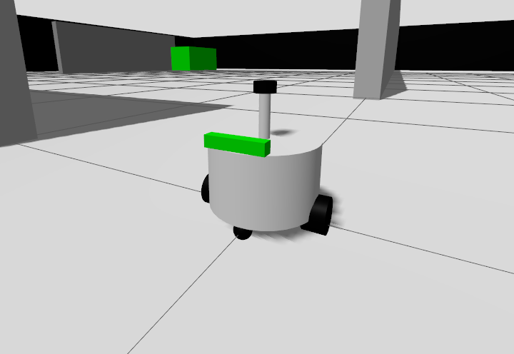
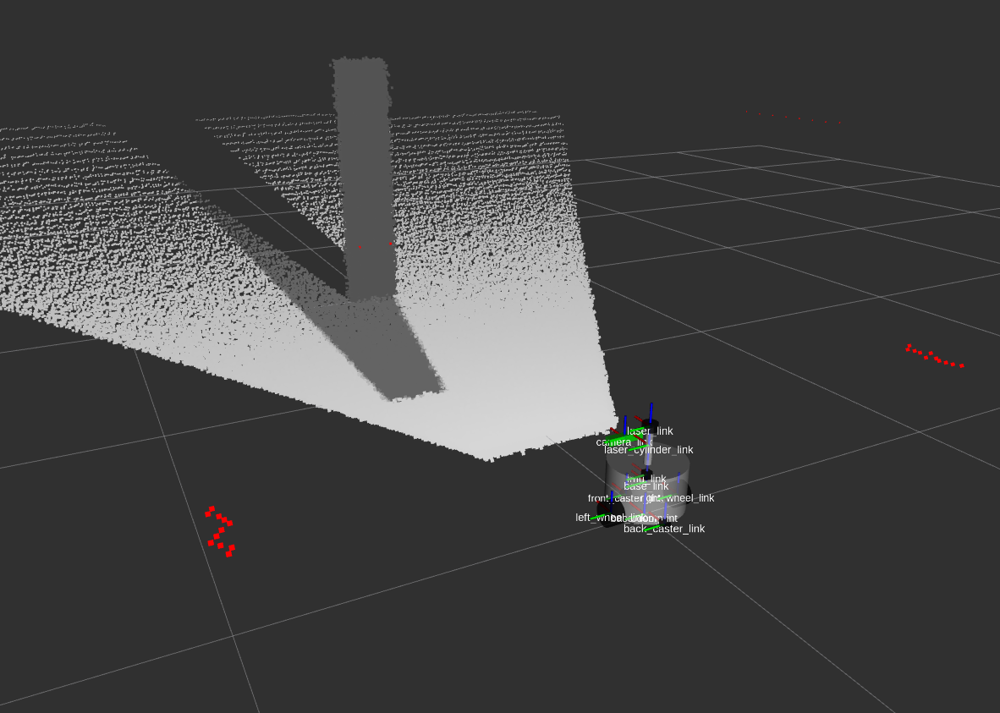

# fishbot for lyrical
## What is this?
This repository provides a Fishbot robot model that supports simulation in ROS 2 Lyrical and Gazebo Jetty. Its appearance and functional implementations are adapted from examples in Chapter 6 of Hands-On ROS 2 for Robotics Programming by Xin Sang (2024).

## Quick Start
1.Specify a ROS 2 workspace, clone this code, and compile it:
```bash
mkdir -p fishbot_ws/src
cd fishbot_ws/src
git clone xxx
cd ..
colcon build
```

2.Launch a fishbot, with controller provided by Gazebo:
```bash
ros2 launch fishbot_description gz_sim.gz_control.launch.py
```
Control the fishbot using teleop_twist_keyboard:
```bash
ros2 run teleop_twist_keyboard teleop_twist_keyboard
```

3.Launch a fishbot, with controller provided by ros2_conrol:
```bash
ros2 launch fishbot_description gz_sim.ros2_control.launch.py
```
Control the fishbot using teleop_twist_keyboard:
```bash
ros2 run teleop_twist_keyboard teleop_twist_keyboard --ros-args -p stamped:=true
```


